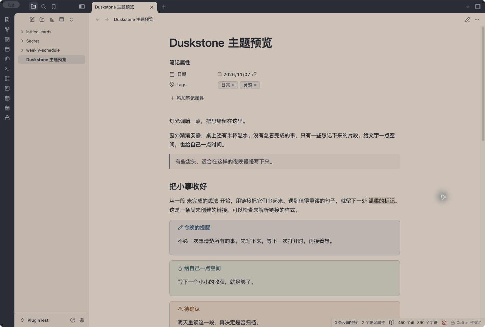
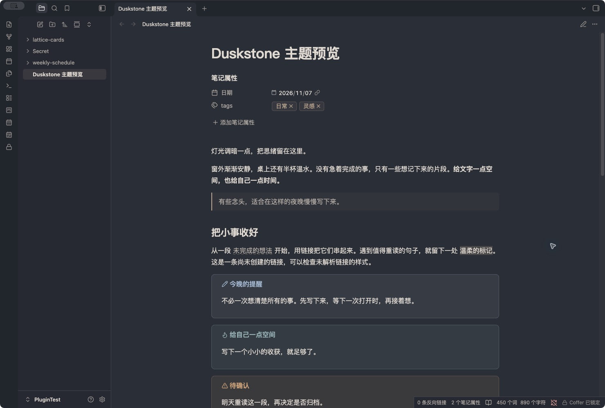

# Duskstone

Warm taupe, charcoal and quiet contrast. An offline, dependency-free Obsidian theme for reading and writing after hours.

[中文说明](README.zh-CN.md) · [Download](https://github.com/xwtaidev/obsidian-duskstone-theme/releases/latest) · [Changelog](CHANGELOG.md)





## Features

- **Light:** warm taupe `#D2C9BF` pages inside a charcoal `#30343E` frame.
- **Dark:** charcoal pages, warm off-white text and muted taupe accents.
- Native reading view, Live Preview and source editor; properties, links, tags, callouts, tasks, code and tables.
- Rounded desktop corners in expanded and collapsed sidebar states. Tab curves stay clear of divider lines.
- Native fonts, layout, accent picker and resize controls. No required plugins, remote fonts, images or scripts.
- Graph and Canvas color variables, plus white-background print styles.

## Install

Requires **Obsidian 1.10.6+**. Duskstone is not yet listed in Community Themes.

1. Download `Duskstone-1.0.0.zip` from the [latest release](https://github.com/xwtaidev/obsidian-duskstone-theme/releases/latest).
2. Extract it into your vault's `.obsidian/themes/` directory:

   ```text
   .obsidian/themes/Duskstone/
   ├── manifest.json
   ├── theme.css
   └── LICENSE
   ```

3. In **Settings → Appearance → Themes**, choose **Duskstone**. Restart Obsidian if it is not listed yet.
4. Select **Light** or **Dark** under **Base color scheme**.

You can also download the individual `manifest.json` and `theme.css` release assets into the same folder. These are the only runtime files; preview files, development dependencies and examples are not installed.

The folder must be named `Duskstone`, matching `manifest.json`. If you tested the earlier **Nights Like This** development build, install this release as **Duskstone** and select it in Appearance. Your notes are unaffected.

## Preview and sample note

Open [preview/index.html](preview/index.html) in a browser, or run `python3 -m http.server 8765 --bind 127.0.0.1` from this repository and visit `http://127.0.0.1:8765/preview/index.html`.

The preview uses the real `theme.css` with a browser-only layout scaffold. It supports light/dark, reading/editing samples, tasks, chapter search (`Cmd/Ctrl + P`) and sidebar controls. Editing is a style sample and does not parse or save Markdown.

Copy [这样的夜晚.md](examples/这样的夜晚.md) into a test vault to inspect real Obsidian rendering. Screenshots above are **real captures of Obsidian 1.14.4 on macOS**, taken in a test vault with the sample note. The interactive browser preview is a separate layout simulation. The store thumbnail is [screenshot.png](screenshot.png), sized 512 × 288.

## Readability and compatibility

Default WCAG contrast ratios against the main note background:

| Pair | Light | Dark |
| --- | --- | --- |
| Body text | 8.45 : 1 | 9.42 : 1 |
| Secondary text | 5.68 : 1 | 6.00 : 1 |
| Links | 5.37 : 1 | 6.01 : 1 |
| Primary button text/background | 7.68 : 1 | 7.03 : 1 |

Verified in browser fixtures with Obsidian 1.12.4's native stylesheet, and visually checked in the Obsidian 1.14.4 macOS test vault for light/dark modes, reading/editing and sidebar corner states. The browser preview was checked at 320–1440px, including search and keyboard controls. Print colors and native accent overrides were also checked.

iOS, Android, every split/stacked layout and third-party plugin combination have not been fully tested. Mobile uses the native layout; graph and Canvas are supplied with color variables. Custom accents or snippets may change contrast. Please [report issues](https://github.com/xwtaidev/obsidian-duskstone-theme/issues) with your Obsidian version, platform and a screenshot.

## Development and releases

The theme itself has no build step. Development checks require Node.js 22+ and Python 3:

```sh
npm ci --ignore-scripts
npm run check
npm run package
```

Checks use Obsidian's official `stylelint-config-obsidianmd`, validate the manifest, version map and screenshot, and check preview JavaScript syntax. The manual-install ZIP is written to `dist/` and is not committed.

To release: update `manifest.json`, `package.json`, `versions.json` and `CHANGELOG.md`, run the checks, commit, then push a matching version tag such as `1.0.1` **without a `v` prefix**. GitHub Actions validates the tag and publishes `manifest.json`, `theme.css` and the ZIP as release assets. Obsidian installs the two individual files from the matching release.

## Community directory submission

After publishing a release, follow the [current theme submission process](https://docs.obsidian.md/Themes/App%20themes/Submit%20your%20theme): sign in to [Obsidian Community](https://community.obsidian.md), link your GitHub account, and create a theme entry with:

| Field | Value |
| --- | --- |
| GitHub repository | `https://github.com/xwtaidev/obsidian-duskstone-theme` |
| Theme name | `Duskstone` |
| Screenshot path | `screenshot.png` |
| Supported modes | Light and Dark |

Review the Developer Policies and submit the entry from your Obsidian account. A GitHub release prepares installation; it does not by itself list the theme in the directory. Theme names cannot be changed after submission.

## Palette credits and license

The starting palette comes from [Nights Like This](https://chromewebstore.google.com/detail/nights-like-this/kpjgpagkiaepkmeamgjaccjgfjgpncac), the Chrome theme by [Tatsze](https://tatsze.com/), version 0.2.1: frame `#30343E`, toolbar/new-tab background `#D2C9BF`, inactive-tab text `#EBEBEB`.

Duskstone is an independent Obsidian adaptation with original CSS, semantic colors, typography, dark mode and preview code. It is not affiliated with or endorsed by Tatsze. No original theme artwork or scripts are included.

Original project code is licensed under [MIT](LICENSE).
