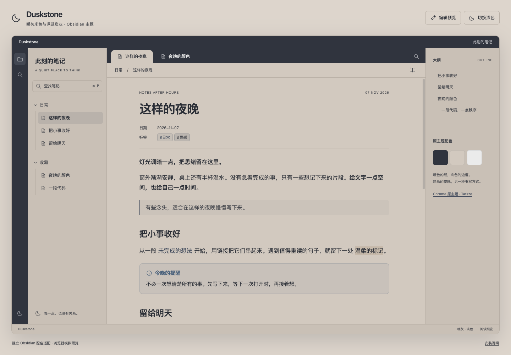
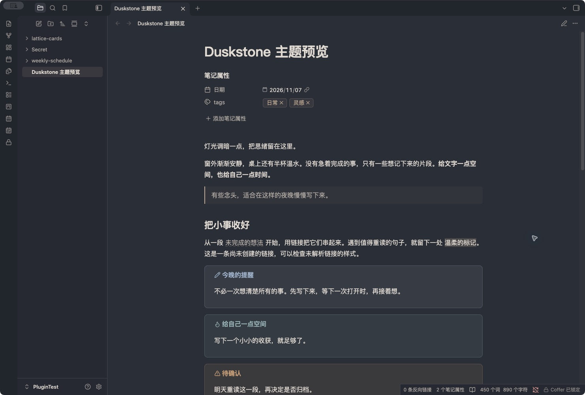

# Duskstone · 暮石

暖灰米色的纸，深蓝炭灰的边框。一款适合阅读与书写的 Obsidian 主题，支持浅色和深色。

[English](README.md) · [下载发行版](https://github.com/xwtaidev/obsidian-duskstone-theme/releases/latest) · [更新记录](CHANGELOG.md)





## 特点

- 浅色以 `#D2C9BF` 为笔记底色，`#30343E` 为标签栏与工具带；深色搭配暖雾白文字。
- 覆盖阅读、Live Preview 与源码编辑、属性、链接、标签、提示块、任务、代码和表格。
- 侧栏展开和折叠时，露出的左上角都保持圆角；标签弧线不被分隔线切开。
- 保留原生布局、字体、强调色和拖动调宽。无网络字体、远程资源或插件依赖。
- 提供关系图、Canvas 配色变量与白底打印样式。

## 安装

需要 **Obsidian 1.10.6 或更高版本**。目前尚未上架社区主题市场。

1. 从 [最新 Release](https://github.com/xwtaidev/obsidian-duskstone-theme/releases/latest) 下载 `Duskstone-1.0.1.zip`。
2. 解压到笔记库的 `.obsidian/themes/`，确认结构如下：

   ```text
   .obsidian/themes/Duskstone/
   ├── manifest.json
   ├── theme.css
   └── LICENSE
   ```

3. 在 **设置 → 外观 → 主题** 中选择 **Duskstone**。如未出现，重启 Obsidian。
4. 在 **基础颜色** 中选择浅色或深色。

也可以下载 Release 的独立附件 `manifest.json` 和 `theme.css`，放进同一目录。预览、示例和开发依赖无需安装。文件夹名称必须为 `Duskstone`，与 manifest 的 `name` 一致。

之前安装过 **Nights Like This** 开发版的用户，请安装新版并在外观中切换到 **Duskstone**；笔记内容不受影响。

## 本地预览与验证

用浏览器打开 [preview/index.html](preview/index.html)，或在仓库目录执行 `python3 -m http.server 8765 --bind 127.0.0.1`，访问 `http://127.0.0.1:8765/preview/index.html`。

支持深浅色、阅读／编辑样式、搜索（`Cmd/Ctrl + P`）、任务勾选和侧栏切换。编辑样例不解析或保存 Markdown。页面直接引用 `theme.css`，由 `preview.css` 模拟布局。

将 [这样的夜晚.md](examples/这样的夜晚.md) 复制到测试库，可检查实机样式。上方截图均来自 **Obsidian 1.14.4 macOS 实机**，使用测试库中的示例笔记；交互式浏览器预览另为布局模拟。市场缩略图是 [screenshot.png](screenshot.png)，尺寸 512 × 288。

默认配色正文对比度：浅色 **8.45:1**、深色 **9.42:1**；链接分别为 **5.37:1** 和 **6.01:1**。

已使用 Obsidian 1.12.4 原生样式进行浏览器检查，并在本机 Obsidian 1.14.4 macOS 测试库查看了深浅色、阅读／编辑与侧栏展开／折叠效果。浏览器预览检查了 320–1440px、搜索、键盘操作、打印配色和自定义强调色。

尚未完成 iOS／Android、所有分屏／堆叠布局和第三方插件组合验收。关系图与 Canvas 提供变量配色。自定义强调色或 CSS 片段可能改变对比度。[反馈问题](https://github.com/xwtaidev/obsidian-duskstone-theme/issues) 时请附上 Obsidian 版本、平台和截图。

## 开发与发布

运行主题不需要构建。开发检查需要 Node.js 22+、Python 3：

```sh
npm ci --ignore-scripts
npm run check
npm run package
```

使用 Obsidian 官方 Stylelint 配置校验 CSS，检查清单、版本映射、缩略图和预览脚本语法。安装包输出到 `dist/`，不纳入 Git。

发布新版时，更新 `manifest.json`、`package.json`、`versions.json` 和 `CHANGELOG.md`，检查通过后提交并推送同版本标签（例如 `1.0.1`，不带 `v`）。GitHub Actions 会发布带有 `manifest.json`、`theme.css` 和 ZIP 的 Release。

## 提交社区主题市场

按 [官方当前流程](https://docs.obsidian.md/Themes/App%20themes/Submit%20your%20theme)，在 Release 发布后，登录 [Obsidian Community](https://community.obsidian.md)，关联 GitHub 账号并新建主题条目：

| 字段 | 内容 |
| --- | --- |
| GitHub 仓库 | `https://github.com/xwtaidev/obsidian-duskstone-theme` |
| 名称 | `Duskstone` |
| 截图路径 | `screenshot.png` |
| 配色模式 | Light、Dark |

阅读开发者政策并从你的 Obsidian 账号提交。GitHub Release 发布完成不代表已经上架市场。主题提交后不能改名。

## 配色来源与许可

起始色板来自 [Tatsze](https://tatsze.com/) 创作的 Chrome 主题 [Nights Like This](https://chromewebstore.google.com/detail/nights-like-this/kpjgpagkiaepkmeamgjaccjgfjgpncac) 0.2.1：`#30343E`、`#D2C9BF`、`#EBEBEB`。

Duskstone 是独立的 Obsidian 适配，CSS、语义色、排版、深色扩展和预览代码为本项目编写，与原作者无隶属或官方授权关系，未包含原主题的美术或脚本。

原创项目代码使用 [MIT](LICENSE) 许可。
